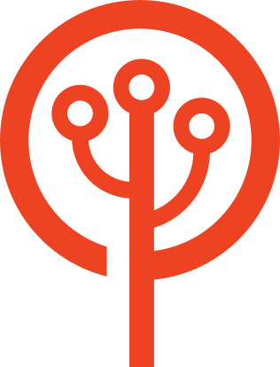

  

[English](https://github.com/coopTilleuls/.github/blob/main/profile/README.md) · **Français**

# 👋 Bienvenue sur le GitHub de Les-Tilleuls.coop

Les-Tilleuls.coop est une [Société coopérative et participative](https://www.les-scop.coop/) (Scop) du numérique, fondée en 2011 à Lille. Nous sommes 80, nous détenons intégralement notre entreprise et nous sommes certifié·es B Corp.

Nous concevons, développons et hébergeons des API, des applications web et des infrastructures cloud, et nous formons les équipes à le faire. Une bonne partie de ce travail se fait en public : nous avons créé des logiciels libres utilisés par des milliers d’équipes dans le monde, et nous contribuons quotidiennement à PHP, Symfony, Caddy et Go.

## 🌱 Tilia, notre structure dédiée à l’IA

En septembre 2026, nous avons lancé [Tilia](https://tilia.coop/fr/) pour aider les organisations à connecter l’IA aux systèmes qu’elles font déjà tourner. Même équipe, même exigence d’ingénierie :

- 🔌 **Serveurs MCP sur mesure** pour relier vos données et vos applications aux assistants IA
- 🤖 **Workflows agentiques** qui prennent en charge les tâches répétitives
- 📚 **RAG, fine-tuning et modèles entraînés sur mesure**
- ☁️ **Architectures cloud souveraines**, déployées et maintenues 24 h/24
- 🎓 [**Formations**](https://tilia.coop/fr/formation/) pour tous les niveaux, par notre organisme certifié Qualiopi
- Et bien plus encore

Notre principe : l’agent IA vous accompagne, c’est vous qui gardez la main.

## 🛠 Les logiciels libres que nous avons créés

| **Projet** | **Description** |
| :--- | :--- |
| [🐲 FrankenPHP](https://github.com/php/frankenphp) | Serveur d’applications PHP moderne, écrit en Go. |
| [🕷 API Platform](https://github.com/api-platform) | API REST et GraphQL, applications web temps réel et API-first, en PHP et TypeScript |
| [💌 Mercure](https://github.com/dunglas/mercure) | Protocole ouvert pour le temps réel, avec une implémentation de référence en Go |
| [🔨 Vulcain](https://github.com/dunglas/vulcain) | API REST rapides et pilotées par le client, protocole ouvert et implémentation en Go |
| [⚡️ React ESI](https://github.com/dunglas/react-esi) | Rendu côté serveur ultra-rapide pour React et Next.js |
| [📄 Doctrine JSON ODM](https://github.com/dunglas/doctrine-json-odm) | ODM pour l’ORM Doctrine, qui s’appuie sur les types JSON des bases de données modernes |
| [🏄 ESQL](https://github.com/soyuka/esql) | PHP Extended SQL, une alternative au DQL |

**Nous contribuons aussi à** [Symfony](https://github.com/symfony) (core team), [PHP](https://github.com/php/php-src) (membres de l’équipe core sécurité et sponsors de la [PHP Foundation](https://thephp.foundation/)), [Caddy](https://github.com/caddyserver/caddy), [Go](https://github.com/golang/go)…

➡️ [Tous nos dépôts](https://github.com/orgs/coopTilleuls/repositories)

## 🤝 La coopérative de l’intérieur

Plus de documentation nous concernant :

- [🌳 Présentation de notre Scop](https://github.com/coopTilleuls/.github/blob/main/profile/scop/README.md)
- [💰 Revenus](https://github.com/coopTilleuls/.github/blob/main/profile/revenues/README.md)
- [🧙 Les échelons de postes et notre grille de salaires](https://github.com/coopTilleuls/.github/blob/main/profile/titles/README.md)
- [🚞 Le guide d’onboarding](https://github.com/coopTilleuls/.github/blob/main/profile/onboarding/README.md)
- [🙋 Recrutement](https://les-tilleuls.coop/la-cooperative/on-recrute) · [simulateur de revenus](https://les-tilleuls.coop/la-cooperative/on-recrute/simulateur-revenus)

## ✉️ Nous contacter

- 🌳 Les-Tilleuls.coop : [les-tilleuls.coop](https://les-tilleuls.coop) · [contact@les-tilleuls.coop](mailto:contact@les-tilleuls.coop)
- 🌱 Tilia : [tilia.coop](https://tilia.coop/fr/) · [formulaire de contact](https://tilia.coop/contact/)
- [Mastodon](https://mastodon.online/@cooptilleuls) · [Bluesky](https://bsky.app/profile/les-tilleuls.coop) · [LinkedIn](https://www.linkedin.com/company/les-tilleuls-coop/) · [X](https://x.com/coopTilleuls)

💡 Inspiration Ce handbook s’inspire du travail de [Basecamp](https://github.com/basecamp/handbook), [24eme](https://github.com/24eme), [Loomio](https://www.loomio.coop/) et [GitLab](https://handbook.gitlab.com/).
