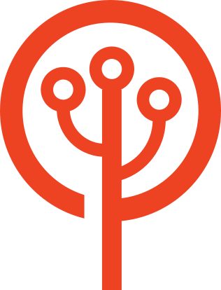

  

**English** · [Français](https://github.com/coopTilleuls/.github/blob/main/profile/README.fr.md)

# 👋 Welcome to Les-Tilleuls.coop on GitHub

Les-Tilleuls.coop is a tech [worker cooperative](https://en.wikipedia.org/wiki/Worker_cooperative) founded in 2011 in Lille, France. We are 80 people, we own 99.9% of the company, and we are B Corp certified.

We design, build and host APIs, web applications and cloud infrastructures, and we train teams to do the same. Much of this work happens in the open: we created open source tools used by thousands of teams around the world, and we contribute to PHP, Symfony, Caddy and Go every day.

## 🌱 Tilia, our AI branch

In September 2026, we launched [Tilia](https://tilia.coop) to help organizations connect AI to the systems they already run. Same team, same engineering standards:

- 🔌 **Custom MCP servers** that plug your data and applications into AI assistants
- 🤖 **Agentic workflows** that take over repetitive tasks
- 📚 **RAG, fine-tuning and custom-trained models**
- ☁️ **Sovereign cloud architectures**, deployed and operated 24/7
- 🎓 [**Training**](https://tilia.coop/training/) for every level, from our Qualiopi-certified training organization
- And much more

Our principle: the AI agent assists you, you stay in control.

## 🛠 Open source we created

| **Project** | **Description** |
| :--- | :--- |
| [🐲 FrankenPHP](https://github.com/php/frankenphp) | Modern PHP app server, written in Go |
| [🕷 API Platform](https://github.com/api-platform) | REST and GraphQL APIs, real-time and API-first web apps, in PHP and TypeScript |
| [💌 Mercure](https://github.com/dunglas/mercure) | Open protocol for real-time updates, with a reference implementation in Go |
| [🔨 Vulcain](https://github.com/dunglas/vulcain) | Fast, client-driven REST APIs, open protocol and Go implementation |
| [⚡️ React ESI](https://github.com/dunglas/react-esi) | Fast server-side rendering for React and Next.js |
| [📄 Doctrine JSON ODM](https://github.com/dunglas/doctrine-json-odm) | Object-Document Mapper for Doctrine ORM, built on the JSON types of modern databases |
| [🏄 ESQL](https://github.com/soyuka/esql) | PHP Extended SQL, an alternative to DQL |

**We also contribute to** [Symfony](https://github.com/symfony) (core team), [PHP](https://github.com/php/php-src) (members of the core security team and sponsors of the [PHP Foundation](https://thephp.foundation/)), [Caddy](https://github.com/caddyserver/caddy), [Go](https://github.com/golang/go)…

➡️ [All our repositories](https://github.com/orgs/coopTilleuls/repositories)

## 🤝 Inside the cooperative

This repository is also our public handbook:

- [🌳 How we work as a worker cooperative](https://github.com/coopTilleuls/.github/blob/main/profile/scop/en/README.md)
- [💰 Revenues](https://github.com/coopTilleuls/.github/blob/main/profile/revenues/en/README.md)
- [🧙 Job titles and salary scale](https://github.com/coopTilleuls/.github/blob/main/profile/titles/en/README.md)
- [🚞 Onboarding guide for newcomers](https://github.com/coopTilleuls/.github/blob/main/profile/onboarding/en/README.md)
- [🙋 Recruitment (🇫🇷)](https://les-tilleuls.coop/la-cooperative/on-recrute) · [salary simulator (🇫🇷)](https://les-tilleuls.coop/la-cooperative/on-recrute/simulateur-revenus)

## ✉️ Get in touch

- 🌳 Les-Tilleuls.coop: [les-tilleuls.coop](https://les-tilleuls.coop/en/homepage) · [contact@les-tilleuls.coop](mailto:contact@les-tilleuls.coop)
- 🌱 Tilia: [tilia.coop](https://tilia.coop) · [contact form](https://tilia.coop/contact/)
- [Mastodon](https://mastodon.online/@cooptilleuls) · [Bluesky](https://bsky.app/profile/les-tilleuls.coop) · [LinkedIn](https://www.linkedin.com/company/les-tilleuls-coop/) · [X](https://x.com/coopTilleuls)

💡 Inspiration: this handbook draws on the work of [Basecamp](https://github.com/basecamp/handbook), [24eme](https://github.com/24eme), [Loomio](https://www.loomio.coop/) and [GitLab](https://handbook.gitlab.com/).
